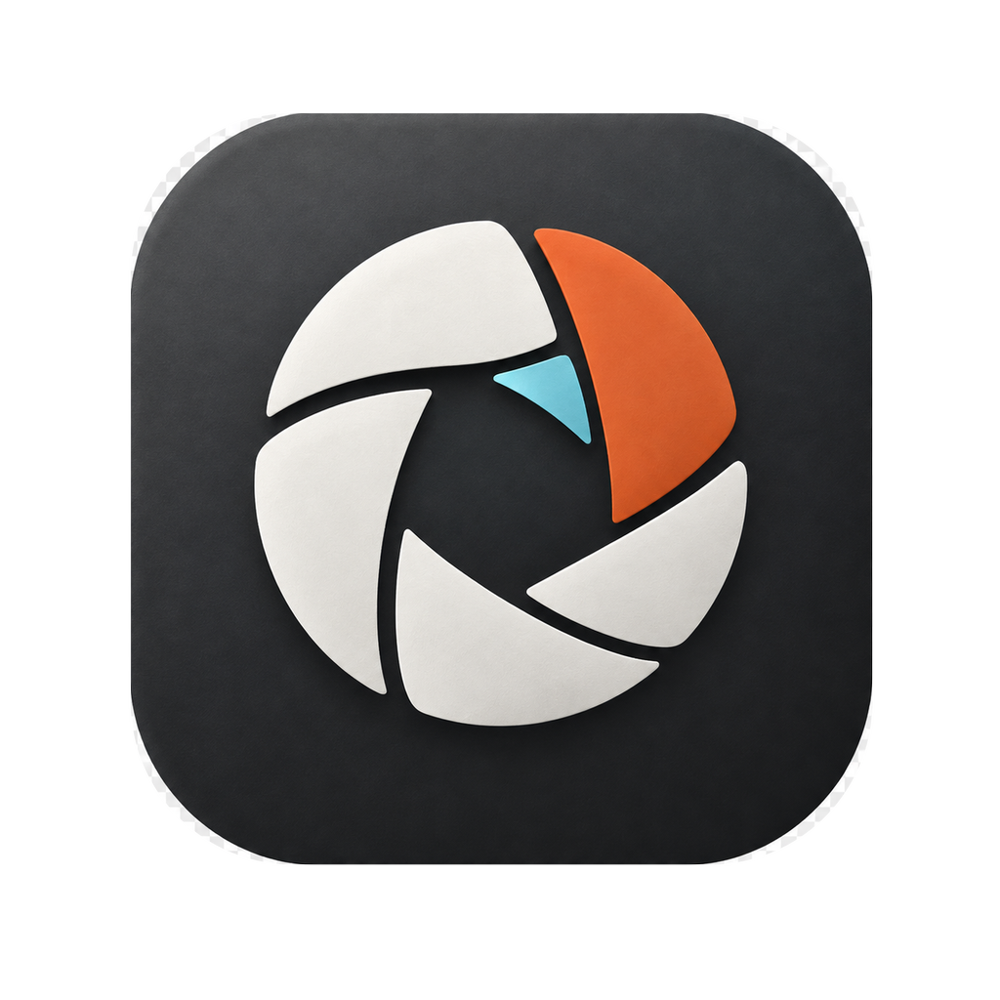
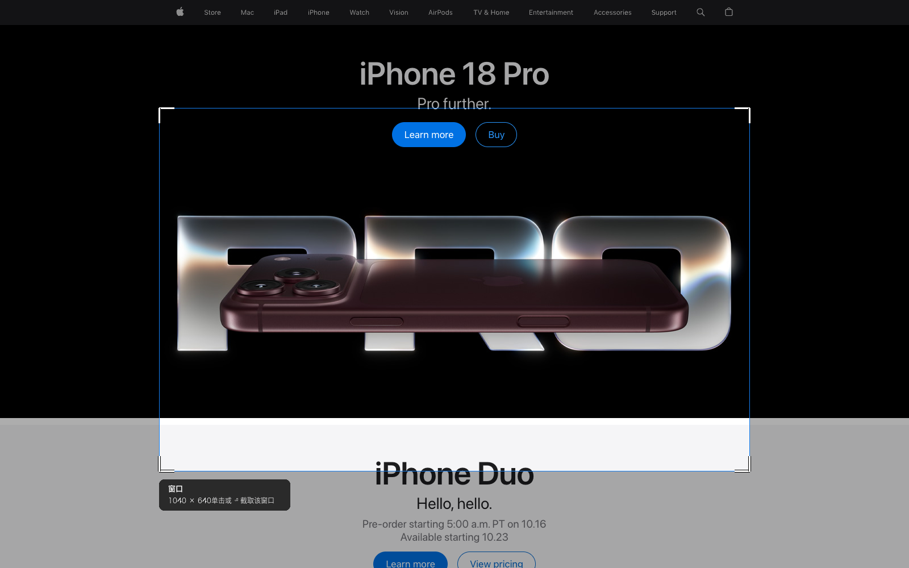
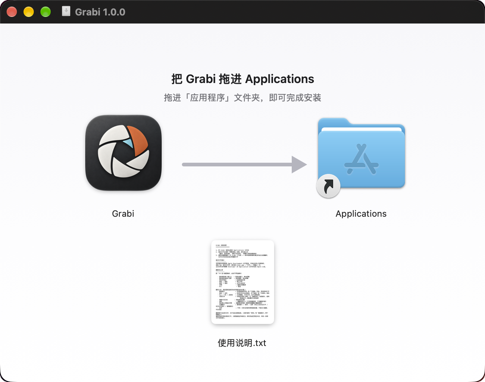
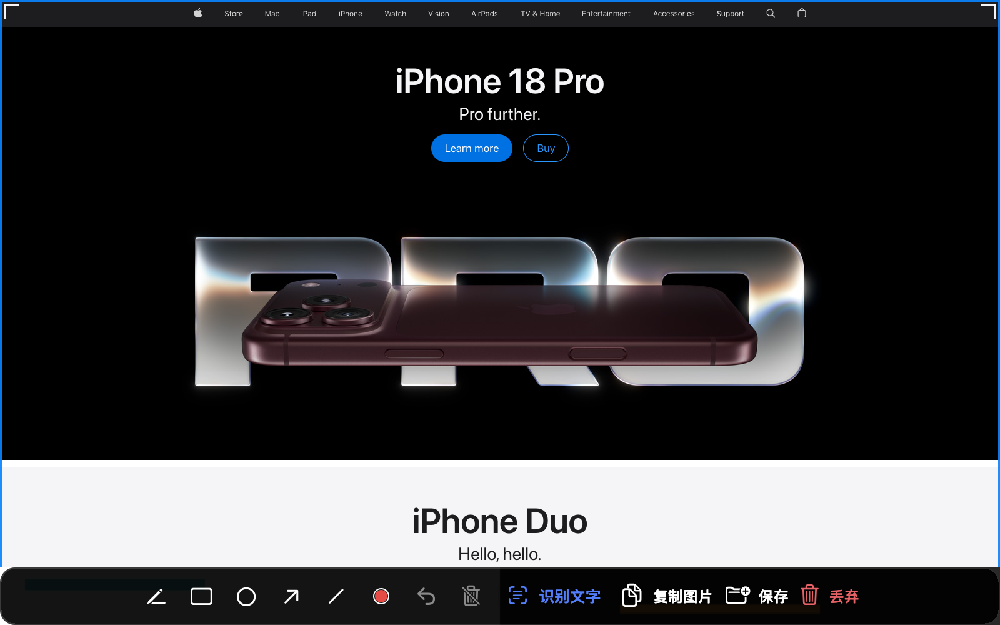

# Grabi



**一个快捷键搞定的 macOS 截图工具。**

Grabi 是一款原生 Swift + AppKit 编写的菜单栏截图工具。它把窗口、区域、全屏截图、
就地预览、标注和离线 OCR 收进同一条流程，不依赖 Electron，不联网，不上传图片。



## 下载

从 [Releases](../../releases) 下载最新的 `Grabi-<版本>.dmg`，双击打开安装窗口，
把左边的 Grabi 拖过箭头，放进右边的 Applications 文件夹即可。



安装窗口里的 `使用说明.txt` 和下面这份文档是同一套内容：怎么截图、快捷键是哪个、
权限怎么给。

如果你的系统拦截了 DMG 里的应用，也可以下载 `Grabi-<版本>.pkg`，通过标准
macOS 安装器安装到 `/Applications/Grabi.app`。安装器会在安装前退出正在运行的
旧版本，并清理旧的 LiteShot、Shutterbox 和用户目录里的重复 Grabi 副本。

也可以下载 ZIP 包。请不要把应用长期放在“下载”目录：开机启动和后台保活只认
`/Applications` 或 `~/Applications`。

当前仓库里的本地构建产物中，`Grabi.app` 使用 `Apple Development` 证书签名，
PKG 安装器尚未使用 `Developer ID Installer` 签名，整体也尚未完成 Apple 公证。
其他 Mac 第一次打开时，如果系统拦截，请右键应用或安装包 →“打开”→ 再确认一次。
macOS 15 及以后，部分情况下需要进入“系统设置 → 隐私与安全性”，点击“仍要打开”。

正式面向所有用户发布时，应改用 `Developer ID Application` 证书签名应用、
使用 `Developer ID Installer` 证书签名 PKG，并完成 Apple 公证。

## 安装

1. 下载 `Grabi-<版本>.dmg`，打开后把 `Grabi.app` 拖进“应用程序”；或直接
   打开 `Grabi-<版本>.pkg`，按安装器向导完成安装。
2. 第一次启动时允许“屏幕录制”权限。
3. 授权后完全退出 Grabi，再重新打开一次。

授权路径：

`系统设置 → 隐私与安全性 → 屏幕与系统音频录制`

Grabi 是菜单栏应用，不显示 Dock 图标。启动后请查看菜单栏右侧的取景框图标。

## 快速开始

默认快捷键是 `⌃⌥A`。

1. 按一次快捷键，进入截图模式。
2. 把鼠标移到窗口上，单击即可截取该窗口。
3. 在空白区域单击，截取整块屏幕。
4. 按住拖动，自由框选区域。
5. 截图完成后，预览面板会直接出现在原来的位置。

| 操作 | 行为 |
|---|---|
| 窗口上单击 | 截取当前窗口 |
| 桌面或空隙单击 | 截取整屏 |
| 按住拖动 | 自由框选 |
| 按住 `⇧` 拖动 | 锁定正方形 |
| 按住 `⌥` 拖动 | 以起点为中心框选 |
| `空格` | 切换到整屏 |
| `⏎` | 采用当前候选 |
| `Esc` | 取消 |

截完之后预览面板就地浮出来，工具栏挂在下面：复制、保存、识别文字、丢弃都在这条
工具栏上，不需要先把图片存下来再找别的软件处理。



## 截图之后

Grabi 不会偷偷保存文件，也不会自动改写剪贴板。你可以明确选择下一步：

| 按钮 | 行为 |
|---|---|
| 复制图片 | 写入剪贴板，预览保持打开 |
| 保存 | 保存到磁盘并关闭预览 |
| 识别文字 | 使用系统 Vision 在本地识别图片文字 |
| 丢弃 | 不保存；已保存过的文件会移到废纸篓 |


进入 OCR 后，工具栏会切换为「复制选中」「复制全文」「复制图片」「回到图片」
以及保存 / 丢弃。没有划选文字时，「复制选中」会明确提示先划一段，不会悄悄
退化成复制全部。

预览面板支持直接标注：

- 画笔
- 矩形
- 椭圆
- 箭头
- 直线
- 六种颜色与三档线宽
- 撤销与清空

标注会随截图一起写出到保存文件。

## 离线 OCR

点击“识别文字”后，Grabi 会使用 macOS 自带的 Vision 框架完成 OCR。

- 支持简体中文、繁体中文、英文、日文、韩文等语言
- 可以直接在图片上拖选文字块
- 可以「复制选中」当前划选的文字，或用「复制全文」复制整张图的识别结果
- 识别全程在本机完成
- 图片和识别结果不会上传


## 菜单栏

菜单栏图标采用简洁的“取景框 + 镜头环”设计，并与应用图标保持同一套图形语言：

- 常态：空心镜头环
- 截图完成：镜头环中心点亮，菜单栏按钮短暂高亮，约 0.9 秒后恢复
- 缺少权限：显示感叹号警告


菜单中可以：

- 开始截图
- 打开最近截图
- 打开保存目录
- 开启或关闭登录时启动与崩溃后重启
- 检查屏幕录制权限
- 打开设置

## 设置

Grabi 支持：

- 自定义全局快捷键
- 自定义保存目录
- 自定义文件名模板
- PNG、JPEG、HEIC 输出
- JPEG / HEIC 质量调整
- OCR 语言选择
- 是否保存 OCR 文本
- 隐藏菜单栏图标

默认截图目录：

`~/Pictures/Grabi/`

默认文件名模板：

`Grabi-{date}-{time}`

## 隐私

Grabi 的核心功能完全在本机完成：

- 不接入网络服务
- 不上传截图
- 不上传 OCR 结果
- 不包含广告或数据统计
- 图片处理使用系统 ScreenCaptureKit 与 Vision

## 系统要求

- macOS 14 或更高版本
- 首次使用需要屏幕录制权限
- OCR 使用系统 Vision
- 后台保活需要 macOS 13 及以上

## 已知限制

- 不支持跨显示器拼接截图，选区会收在起始屏幕内
- 第一次注册后台项后，系统可能要求在“登录项与扩展”中再确认一次
- 当前本地发布包使用 Apple Development 签名，外部用户需要手动确认打开
- 面向所有人正式分发时，需要 Developer ID 签名与 Apple 公证

如果应用损坏或无法打开，先确认文件确实来自本仓库，再执行：

```bash
xattr -dr com.apple.quarantine "/Applications/Grabi.app"
```

这个命令只用于手动安装测试，不应作为公开分发的长期方案。

## 从源码构建

需要 macOS 14+ 与 Xcode Command Line Tools。

```bash
git clone <repo-url> Grabi
cd Grabi
./build.sh release install
```

`install` 会优先同步到已有的安装位置：

1. `/Applications/Grabi.app`
2. `~/Applications/Grabi.app`

安装时会清掉旧的 `Shutterbox` 与 `LiteShot` 副本，避免两个版本同时启动。

构建完成后运行：

```bash
open ~/Applications/Grabi.app
```

如果安装位置不同，请使用实际路径。

## 打包发布

```bash
./package.sh
```

输出：

```text
dist/Grabi-<版本>.dmg
dist/Grabi-<版本>.pkg
dist/Grabi-<版本>.zip
```

PKG 是标准 macOS 安装器，会安装到 `/Applications/Grabi.app`。ZIP 使用 `ditto`
生成，以保留 app bundle 签名和扩展属性。

DMG 的安装窗口不是 hdiutil 的默认排版：背景图由
`tools/make-dmg-background.swift` 画出来，图标位置和窗口尺寸写在 `package.sh`
的 AppleScript 里，两份坐标要对齐（背景上那支箭头指着 Applications）。
没有 Finder 自动化权限的机器（比如 CI）会退化成朴素 DMG，安装方式不变，只是少了
背景图和排好队的图标。

发布脚本会优先使用 `Developer ID Application` 证书。配置好 `notarytool`
凭据后，可以自动提交 Apple 公证并 `stapling`：

```bash
xcrun notarytool store-credentials "grabi-notary" \
  --apple-id "你的 Apple ID" \
  --team-id "你的 Team ID" \
  --password "应用专用密码"

./package.sh
```

## 权限排查

屏幕录制权限绑定代码签名。ad-hoc 签名每次重新编译都可能让旧授权失效；
当前本地构建使用 Apple Development 证书，连续使用同一个签名身份时通常不需要
重复授权。若重新签名或授权记录损坏，再按下面的步骤重置。

检查当前状态：

```bash
/Applications/Grabi.app/Contents/MacOS/Grabi --diagnose
```

重置权限记录：

```bash
tccutil reset ScreenCapture com.momoxiao.grabi
```

然后重新打开 Grabi，并再次授予屏幕录制权限。

如果 Chrome 全屏时截到的是一条顶部工具栏，而不是网页正文，请确认运行的是
最新版 Grabi。窗口候选会优先选择同一应用、同一屏幕上的主窗口，忽略全屏
辅助层。

## 开发

项目结构：

```text
Sources/Grabi/
├── main.swift
├── AppController.swift
├── Capture/
├── OCR/
├── System/
├── Support/
└── UI/
```

运行自检：

```bash
swift build -c release

.build/release/Grabi --logic-selftest
.build/release/Grabi --ui-render /tmp/grabi-ui
```

详细设计记录、行为决策和回归测试说明见
[docs/DEVELOPMENT.md](docs/DEVELOPMENT.md)。

## 图标实现

状态栏图标由 `Sources/Grabi/UI/StatusIcon.swift` 在 16pt 网格上绘制，
使用模板图，由 macOS 根据浅色或深色菜单栏自动解算颜色。

应用图标源文件位于：

`assets/generated/grabi-appicon.png`

重新生成 `Resources/AppIcon.icns`：

```bash
./tools/make-icon.sh
```

## License

[MIT](LICENSE)
